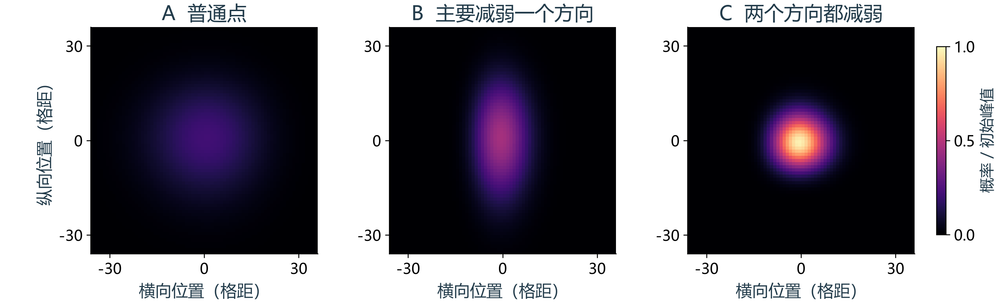
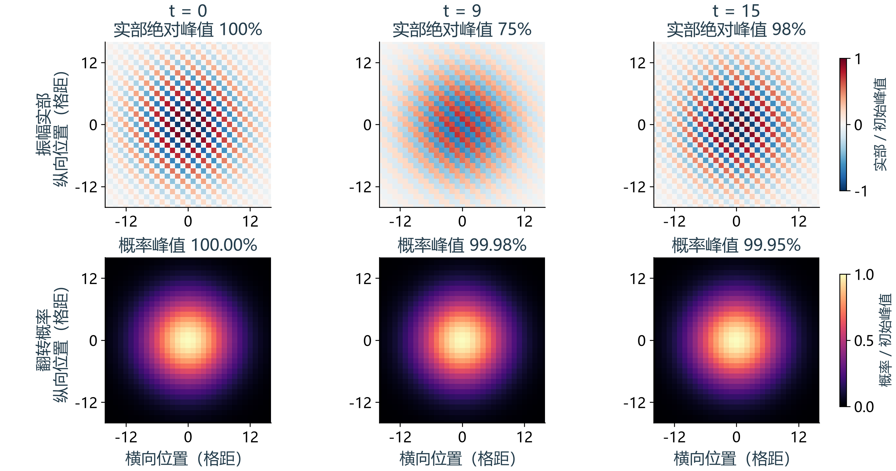
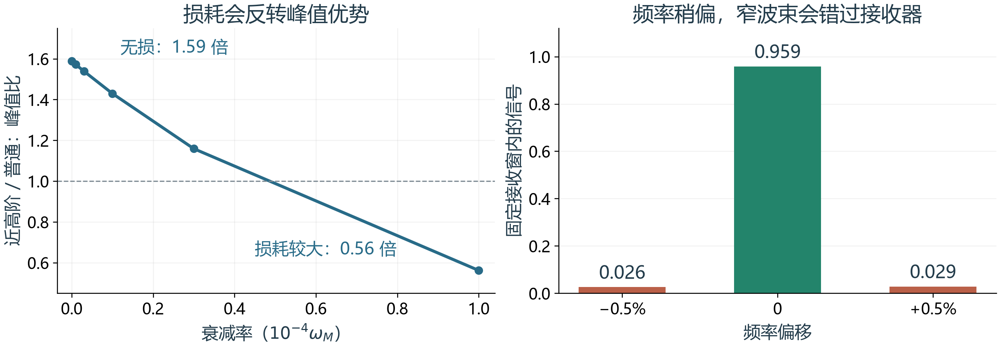
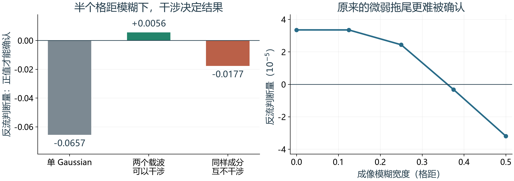

# 自旋波传播研究整理报告

从一个会移动的波包，到几个值得继续的问题

2026 年 10 月 21 日

这项工作从一个简单问题开始：在一排或一片相互耦合的自旋中，能不能让一团激发走得更远，同时少一些散开？

我们先整理了单磁子的推导和传播程序，比较不同波矢下的 Gaussian 波包，再追踪图像中的闪烁和长时间形变。随后查阅相关文献，挑出作者留下的具体问题，做了四个小规模测试。

目前最清楚的结果是：选择合适的波矢，确实能让波包更久地保持紧凑，但它最终仍会变形。这一基本做法已有很直接的先例。更值得继续的问题，是把有限的激发范围、传播损耗和接收器一起考虑，看看信号究竟能不能更好地送到需要的位置。

本报告用图和文字说明这条工作主线。完整推导、文献原文、代码、数据和动画放在同一资料包中，需要细节时可以沿索引继续查看。

## 先看哪里

| 想了解的内容 | 从哪里开始 |
|---|---|
| 工作经过与主要结论 | 这份报告 |
| 四个新测试的动画 | research/wavepacket-prospects/index.html |
| 原始推导 | Note/single_magnon_derivation/main.pdf |
| 最新汇报 | presentations/midterm/output/ 中的“统一符号与传播优化版” |
| 下载文献与代码入口 | 资料包首页的分类索引 |

<!-- page -->

# 一、波包为什么会散开

当前的起点是一个正方晶格模型。每个格点上放一个自旋，相邻自旋通过交换作用相互影响。单磁子态可以理解为：一个自旋翻转的激发分布在许多格点上，每个格点都有一个概率振幅。

计算时，我们先给定初始振幅，再把它分解成不同波矢的模式。每个模式按自己的能量演化，最后重新叠加回各个格点。程序就是用这条路线得到传播动画的。

一个局域波包包含许多波矢。如果这些成分走得快慢不同，波包就会散开。我们比较了三种中心波矢：普通点 A、主要减弱一个方向展宽的 B，以及同时减弱两个方向展宽的交点 C。三组起初都是同样大小的圆形 Gaussian。

当初宽为 6 个格距、两个方向耦合相同时，演化到同一时刻 t = 180 ħ/Jx，结果如下：

| 波包 | 横向宽度 | 纵向宽度 |
|---|---:|---:|
| A：普通点 | 12.92 | 12.92 |
| B：一个方向得到抑制 | 6.06 | 12.92 |
| C：两个方向同时得到抑制 | 6.06 | 6.06 |

宽度都以格距为单位。B 只改善了一个方向，C 则把两个方向的展宽都压低了。对于这个模型，这两个方向可以分别计算，再组合成二维结果。

继续改变初宽，还能看到一个简单规律：普通点的保形时间大致随初宽的平方增长，交点大致随初宽的三次方增长。包越宽，交点的优势越明显。

<!-- page -->

# 二、看起来闪烁，不等于波包在消失

交点动画里最先引起注意的是红蓝图忽明忽暗。追踪后发现，图中画的是振幅的实部。即使振幅大小几乎没变，相位的转动也会让实部从正值经过零，再变成负值，颜色就会在红、白、蓝之间变化。

同一组数据可以把这件事看得很清楚。在时间从 0 走到 9 时，实部的最大绝对值降到初始值的约 75%，概率峰值却仍保留 99.98%。到时间 15，实部又变深了，概率峰值仍几乎没有变化。动画抽帧还把快速的相位变化显示成了较慢的起伏。

不过，延长演化后确实会出现真正的变化。波包逐渐偏斜，后方长出小旁瓣；有些地方的概率流会短暂反向。这种反流能用截面两侧的概率增减核对，与红蓝颜色无关。

自然 Gaussian 拖尾中的反流很小。我们找到的一段事件，反向通过截面的概率约为总概率的 0.00335%。晶格反流已有专门研究[10]，这里的工作是在这类 Gaussian 波包中把它追踪出来。

<!-- page -->

# 三、把我们的结果放回已有研究

查文献以后，最重要的认识是：交点附近的低展宽传播不是一个刚出现的想法。2004 年，Osborne 和 Linden 就在 Heisenberg 自旋链中使用中心位于 ka = π/2 的 Gaussian 波包，并讨论了后续的三阶形变。[1]

2007 年的二维光学波导工作直接比较了普通入射、只有一个方向取 π/2、两个方向都取 π/2 的传播。[2] 2009 年 Longhi 又系统分析了这种低展宽传播及其长期变化。[3] 这些工作帮助我们确认：当前模拟抓住了已有研究中的传播机制。

已知的机制仍然可以有新用途。2025 年的一项量子时钟研究，就利用低展宽波包来改善到达时间的稳定性。[4] 对我们来说，下一步的价值更可能来自明确的使用场景：怎样激发、传播多远、允许多少损耗，以及接收器实际测到什么。

## 本轮最值得先读的文献

| 文献 | 它帮助我们回答什么 |
|---|---|
| Osborne 与 Linden，2004 [1] | 自旋链中的 Gaussian 为什么可以走得较远 |
| Chen 等，2007；Longhi，2009 [2,3] | 两个方向的传播怎样比较，为什么后来仍会展宽 |
| Divinskiy 等，2021 [5] | 真实磁性波导中，短脉冲能否少一些展宽 |
| Wartelle 等，2023 [6] | 怎样选择能形成定向窄波束的位置 |
| Casulleras 等，2023 [7] | 能否从想要的接收波形反过来设计输入 |
| 两篇反流工作，2026 [8,9] | 如何把小幅反流变成可判断的测量结果 |

我们还专门核对了结论和展望。有些旧稿中的问题已经在正式发表版里补做，有些结尾只是在总结结果。下面四个测试，来自仍然具体、又能在现有工作上迈出一步的问题。

<!-- page -->

# 四、优先方向：让窄波束真正落进接收器

有些色散位置会让许多成分朝接近的方向传播，于是形成窄而集中的波束。相关文献称它们为 caustic 波束。Wartelle 等还找到一类位置，附近波矢改变时，传播方向变化得更慢。但在有限激发范围内，它究竟能多集中多少信号，还需要计算。[6] 下文沿用论文的叫法，称它为近高阶点。

我们采用论文给出的色散和参数，让普通点与近高阶点使用同样宽的输入、走同样远的距离。无损计算中，近高阶点的峰值约为普通点的 1.59 倍，进入固定接收窗口的信号也更多。

真正有用的发现来自后两个对照。首先，近高阶波束走得较慢，损耗积累更多；损耗增大后，峰值比从 1.59 降到 0.56，原来的优势反而消失。其次，只改变约 0.5% 的频率，波束峰值仍然很高，却偏离了原来的接收方向。接收窗口中的信号从约 0.96 降到约 0.03。

所以，接下来不应只寻找“最亮的点”，而应直接比较接收器能收到多少。这个方向最值得继续：把真实天线、材料损耗和接收位置放进同一套计算，再看优势能否保留下来。本次完成的是波束几何的简化测试，还没有把它换算成真实器件的功率。

<!-- page -->

# 五、第二方向：让反流成为测得出的信号

反流的困难不只在于它小。测量图像稍微模糊一些，邻近位置的正向和反向变化就会混在一起。2026 年的相关论文把这件事明确列为需要继续研究的问题。[8,9]

我们先检查原来的 Gaussian 拖尾。当成像模糊的宽度达到半个格距时，原先能够确认的反流便无法确认了。这个结果说明，自然拖尾不是一个很好的实验起点。

然后，我们在同样的初始空间范围内，把两个不同载波相干叠加，并固定观察位置和时间。新的制备在半格点模糊下仍能确认反向概率流；改成互不干涉的混合后，便不能确认同样的反流信号。这一对照说明，干涉是信号的关键。

这条路仍有较高的测量成本。在所用计数模型下，确认信号需要每组约 25 万至 40 万次重复测量，共三组；实际仪器噪声尚未计入。我们也发现，把已知的成像模糊纳入判断规则，可以减少所需次数，甚至改变两种输入波形的优劣排序。

因此，这个方向可以继续，但目标应是“用有限制备和有限测量次数确认反流”，而不是一味放大某个瞬时负流峰值。报告中的数字来自格点模型，落到实验上还需要确定格距对应多大的实际长度。

<!-- page -->

# 六、另外两个测试帮我们排除了什么

## 补偿损耗，可以换来更好的相位匹配

Casulleras 等提出，可以把随波长变化的损耗加入脉冲逆设计。[7] 我们在相同输入预算下比较了几种方法。补偿后，输出与目标振幅和相位的吻合程度从约 0.80 提高到 0.95，但匹配到目标波形的信号量少了约四成。

如果只比较强度轮廓，原方法其实已经接近目标，补偿带来的变化很小。进一步加入参数误差后，更复杂的设计也没有显示额外优势。只有接收任务确实需要相位匹配时，才可能值得付出信号变弱的代价。2026 年的综述也把激发方式和误差容限列为值得推进的方向。[11]

## 两种无序的差别，主要来自散射强度

另一个问题来自量子时钟论文：格点本身的频率误差，与相邻格点之间的耦合误差，是否造成相近的影响？[4]

第一轮用相同的总扰动量比较，两种误差下的接收概率分别约为 0.67 和 0.48，看起来差得很多。再把它们将波反射回去的能力匹配起来，两者都变成约 0.67，主要差异消失了。

| 对照方式 | 局部频率误差 | 相邻耦合误差 |
|---|---:|---:|
| 相同总扰动量 | 0.6710 | 0.4757 |
| 相同的后向散射强度 | 0.6710 | 0.6711 |

这个否定结果也有用：后续比较不同误差时，要先说明“同样大”是什么意思。它没有给出值得另立新方向的保护机制，因此保留为以后比较误差时的对照即可。

四个测试的模型各有侧重，动画、参数和检查记录都已放在 Demo 目录中。今后若换成真实材料，最先需要补的是激发和接收的具体条件。

<!-- page -->

# 七、整理后的资料怎样使用

资料包保留了原来的代码相对路径，方便脚本找到数据和图像。阅读时不需要从文件夹里逐个猜版本，先打开“先读这里”即可。

| 目录 | 内容与用途 |
|---|---|
| literature | 已下载的文献、版本信息、阅读说明和统一文献目录 |
| code | 早期传播程序、修正后的模型及测试 |
| Note | 当前单磁子推导，以及保留的早期笔记 |
| figures | 色散图、传播图、长时间追踪、动画、数据和核对记录 |
| presentations | 最新汇报、预览 PDF、编辑源文件和历史版本 |
| research | 四个新测试、研究汇总和离线 Demo 页 |
| report | 本报告的文字、插图与生成脚本 |

当前建议以单磁子推导讲义和“统一符号与传播优化版”汇报为主。早期 toy model 笔记和旧汇报都保留，供追溯过程，不再作为默认入口。

这次共整理了 37 份文献 PDF，其中 8 份是本轮补下的。目录按问题分类，记录标题、作者、年份、原始网址和本地文件。另有 7 项未取得原文，已保留书目信息和获取记录。正式版与预印本放在同一条目下，版本分别标明。

## 建议的下一步

先把精力放在定向窄波束的实际接收收益上。沿用本轮已经跑通的计算，加入真实天线和损耗，固定接收位置，再检查频率和材料参数稍有变化时能否保持优势。

反流作为第二条线，优先研究容易制备、容易测量的状态。原自然拖尾已经显示出明显的检测困难，可以把注意力转向更合适的输入与测量方式。

损耗补偿和无序对照则保留为工具：前者帮助理解相位匹配需要付出多少代价，后者提醒我们公平比较误差。这样可以把后续工作集中到两个真正具体的问题上，同时保留已经完成的推导、程序和测试。

<!-- page -->

# 参考文献

[1] T. J. Osborne and N. Linden. Propagation of quantum information through a spin system. Physical Review A 69, 052315 (2004). DOI: 10.1103/PhysRevA.69.052315.

[2] H. Chen, X. Chen and Y. Xia. The peculiarities of discrete diffraction in two-dimensional optical waveguide arrays. Optics Communications 271, 382-385 (2007). DOI: 10.1016/j.optcom.2006.10.031.

[3] S. Longhi. Discrete diffraction and shape-invariant beams in optical waveguide arrays. Physical Review A 79, 033847 (2009). DOI: 10.1103/PhysRevA.79.033847.

[4] F. Meier et al. Precision is not limited by the second law of thermodynamics. Nature Physics 21, 1147-1152 (2025). DOI: 10.1038/s41567-025-02929-2.

[5] B. Divinskiy et al. Dispersionless propagation of ultra-short spin-wave pulses in ultrathin yttrium iron garnet waveguides. Physical Review Applied 16, 024028 (2021). DOI: 10.1103/PhysRevApplied.16.024028.

[6] A. Wartelle et al. Caustic spin wave beams in soft, thin films: properties and classification. Physical Review B 107, 144431 (2023). DOI: 10.1103/PhysRevB.107.144431.

[7] S. Casulleras et al. Generation of Spin-Wave Pulses by Inverse Design. Physical Review Applied 19, 064085 (2023). DOI: 10.1103/PhysRevApplied.19.064085.

[8] T. Paterek and A. Goussev. General Quantum Backflow in Realistic Wave Packets. Physical Review Letters 136, 090202 (2026). DOI: 10.1103/tm9s-pkg5.

[9] Y. Chen and Y. Tang. Preparing Quantum Backflow States by Large Momentum Transfer. Physical Review A 113, 063304 (2026). DOI: 10.1103/3b4f-6nfr. arXiv:2602.12767v2.

[10] F. R. Torres Arvizu, A. Ortega and H. Larralde. Quantum backflow in biased tight-binding systems. Physical Review A 113, 032218 (2026). DOI: 10.1103/v49b-zz68.

[11] F. Vilsmeier et al. Perspectives on inverse design for AI magnonics. arXiv:2607.07324v1 (2026).

更多文献、原文页码和阅读记录见统一文献目录。
