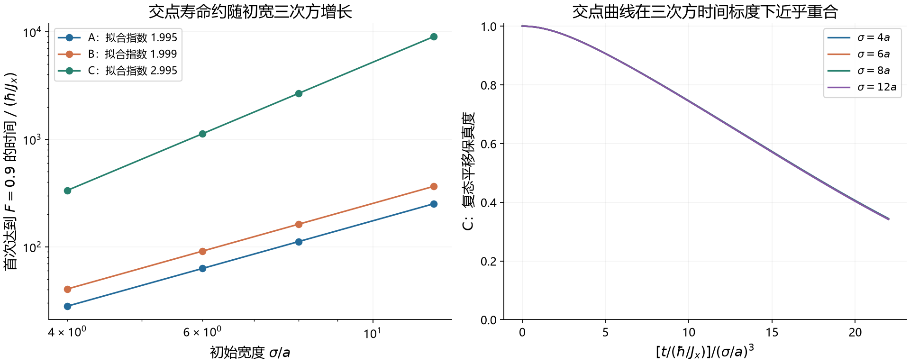
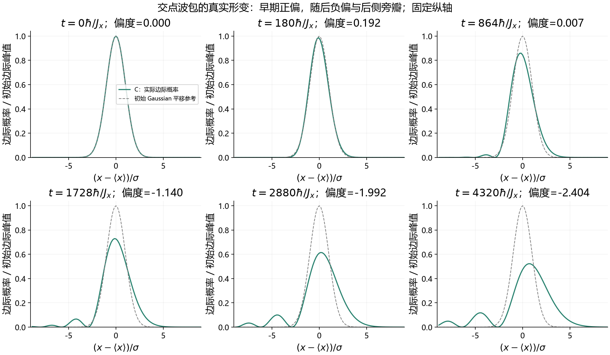
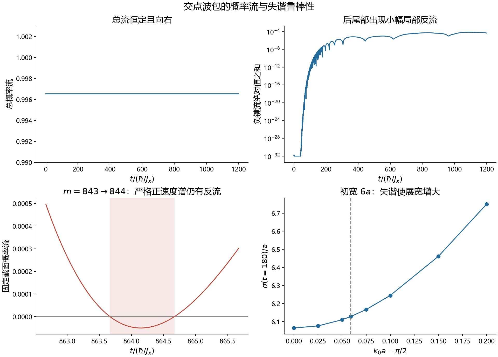

# 余弦晶格波包的动力学追踪与文献对照

检索与计算日期：2026 年 10 月 20—21 日，Asia/Shanghai。

当前动画中的核心效应——在 \(ka=\pi/2\) 附近减弱二阶色散、交点同时减弱两个方向的展宽、随后出现三阶色散形变——已有直接先例。把它改述为“高斯曲率交点保形”并不增加新的物理机制。新的追踪还在 Gaussian 的后尾部确认了很小的、整体相位不变的反向概率流；晶格 quantum backflow 本身也已有文献，当前结果提供了一个自然演化的 Gaussian 实例，尚不足以主张新颖性。

这些结果仍有研究价值：它们明确了保形的有限时间范围、载波失谐容限、相位图与可观测概率流的区别，以及从可分离 toy model 走向真实二维磁子能带时必须增加的检验。

## 计算对象与比较约定

模型保持为无外场、无阻尼的单磁子最近邻正方晶格：

\[
\varepsilon(\mathbf k)
=J_x[1-\cos(k_xa)]+J_y[1-\cos(k_ya)].
\]

初态为相同概率包络的乘积 Gaussian，
\[
\psi(x,y,0)\propto
\exp\!\left[-\frac{x^2+y^2}{4\sigma^2}\right]
e^{i(k_{x0}x+k_{y0}y)},\qquad x,y\in a\mathbb Z.
\]
这里 \(\sigma\) 是每个方向的初始概率 RMS 宽度。三组中心波矢为
\[
A=(0.7,0.7),\quad B=(\pi/2,0.7),\quad
C=(\pi/2,\pi/2),
\]
上述坐标均表示 \((k_{x0}a,k_{y0}a)\)。

- 对 A/B/C 分别取 \(J_y/J_x=1,0.3\)，共六组，固定 \(\sigma=6a\)，从原来的 \(t=180\hbar/J_x\) 延长到 \(4320\hbar/J_x\)。
- 追踪总概率、质心、RMS 宽度、偏度、超额峰度、峰值、完整概率轮廓、复态平移重叠、概率形状重叠和概率流。
- 扫描 \(\sigma/a=4,6,8,12\) 的保形寿命，并检查偏离交点的载波失谐。
- 比较以相同初宽、相同时间为主；寿命数据另记传播距离，未将不同速度的等时间比较误称为等距离比较。

复态重叠采用
\[
F(t)=\left|\sum_{m,n}\psi_{\rm ref}^{*}(m,n,t)\psi(m,n,t)\right|^2,
\]
其中参考态是初态按其频谱平均速度刚性平移后的态；非整数格点平移通过 Fourier 相位定义。概率形状重叠另用
\[
D(t)=\left[\sum_{m,n}\sqrt{P_{\rm ref}(m,n,t)P(m,n,t)}\right]^2.
\]
两者不能互相替代；\(F\) 检查复振幅，\(D\) 只检查概率分布。

## 追踪得到的物理结果

### 两个方向的改进来自可分离动力学

当前单磁子算符满足
\[
H-E_F=H_x\otimes I+I\otimes H_y.
\]
因此乘积初态始终有
\[
\psi_{m,n}(t)=\psi_m^{(x)}(t)\psi_n^{(y)}(t).
\]
B 的 \(x\) 向结果与 C 相同，B 的 \(y\) 向结果与 A 相同。直接二维 FFT 与乘积计算的代表性振幅 L2 差小于 \(3.5\times10^{-14}\)。

这解释了交点的优势，也限定了其意义：现有计算没有额外的不可分二维传播机制。这里的坐标可分离并不意味着自旋分区之间不存在量子纠缠。

在 \(J_y=J_x,\sigma=6a,t=180\hbar/J_x\) 时：

| 中心 | \(\sigma_x/a\) | \(\sigma_y/a\) | \(F\) | \(D\) |
|---|---:|---:|---:|---:|
| A 普通点 | 12.9241 | 12.9241 | 0.52330 | 0.58357 |
| B 单条零曲率线 | 6.0643 | 12.9241 | 0.72211 | 0.76257 |
| C 交点 | 6.0643 | 6.0643 | 0.99646 | 0.99648 |

### 保形时间的初宽标度从二次变为三次

扣除能量常数及产生平移的一次项后，普通点仍有二次谱相位；交点的首项为
\[
-\frac{a^3}{6}
\left[J_x(\delta k_x)^3+J_y(\delta k_y)^3\right].
\]
Gaussian 的谱宽与 \(1/\sigma\) 成正比，因此固定形变容限下的典型时间尺度分别为
\[
t_{\rm ordinary}\sim\frac{\hbar}{J_x}(\sigma/a)^2,\qquad
t_{\rm crossing}\sim\frac{\hbar}{J_x}(\sigma/a)^3.
\]
常数取决于形变指标和阈值。

以下初宽扫描固定 \(J_y=J_x\)，以 \(F\) 首次降至 0.9 定义寿命，数值为：

| \(\sigma/a\) | A | B | C |
|---:|---:|---:|---:|
| 4 | 28.065 | 40.555 | 335.019 |
| 6 | 62.931 | 91.211 | 1127.146 |
| 8 | 111.743 | 162.132 | 2668.821 |
| 12 | 251.205 | 364.766 | 9000.209 |

时间单位为 \(\hbar/J_x\)。四个宽度点的 log–log 拟合斜率依次为 1.995、1.999、2.995。改变为 \(F=0.5\) 或首个方向宽度翻倍，得到相同的二次／三次标度趋势。这里的寿命标度不表示固定初宽波包的长期 RMS 宽度按 \(t^{1/3}\) 增长；后者仍由速度方差给出长期线性增长。Osborne–Linden、Thompson 等及 Longhi 的工作已覆盖相应机制和误差框架，见后面的文献对照。

### 波包先偏斜再发展出明显旁瓣

C 在较长时间仍然变形：

| \(t/(\hbar/J_x)\) | 每轴 RMS 宽度 /\(a\) | 每轴偏度 | 每轴超额峰度 | \(F\) |
|---:|---:|---:|---:|---:|
| 180 | 6.0643 | +0.1925 | 0.0058 | 0.99646 |
| 864 | 7.3400 | +0.0066 | 1.3090 | 0.93473 |
| 1728 | 10.3683 | −1.1401 | 5.2417 | 0.81203 |
| 4320 | 21.9747 | −2.4036 | 10.1377 | 0.40417 |

偏度在 \(t\simeq869.2614\hbar/J_x\) 从正变负。因此早期形变不能一概解释为慢分量形成后拖尾；完整的相干形变包含先后不同阶段。偏度重新接近零也不代表恢复 Gaussian：在 \(t=864\hbar/J_x\) 时，超额峰度和可见旁瓣都已经非零。三阶、四阶矩已用独立的 Gaussian 谱累积量表达式核对。

对于 \(J_y/J_x=0.3\)，两个方向主要按不同的演化时钟发展。例如 \(t=1728\hbar/J_x\) 时，C 的 \(x\) 偏度为 −1.140，而 \(y\) 偏度仍约 +0.301。这来自可分离色散中 \(y\) 方向时间尺度的改变。

### 实部闪烁与真实反流是两件事

此前动画的红蓝闪烁已由相位投影及抽帧混叠解释。在交点的实 Gaussian 初态下，
\[
\psi_{m,n}
=e^{i\pi(m+n)/2-i(J_x+J_y)t/\hbar}u_{m,n}(t),
\qquad u_{m,n}(t)\in\mathbb R.
\]
公共相位会改变 \(\operatorname{Re}\psi\)，不会改变概率或以下键流：
\[
j^x_{m,n}=\frac{J_x}{\hbar}
\operatorname{Im}(\psi_{m,n}^{*}\psi_{m+1,n}).
\]
在上述交点表示中，
\[
j^x_{m,n}=\frac{J_x}{\hbar}u_{m,n}u_{m+1,n}.
\]

长时演化产生带符号旁瓣后，相邻格点的实包络乘积可以为负。这个量是整体相位不变的，代表真正的局部反向概率流，而不是颜色变化。

在 \(\sigma=6a,J_y=J_x\) 的 C 波包中，选固定截面 \(m=843\to844\)，对 \(y\) 求和。将初态严格投影到 \(\sin(k_xa)>0\) 的谱子空间后，仍得到：

\[
tJ_x/\hbar\in[863.6666618,\;864.6700074],
\qquad
\int j^x_{\rm cut}(t)\,dt=-3.3519983\times10^{-5}.
\]

截面右侧概率减少、左侧概率增加，与该积分相符；另一周期边界的通量可忽略。将计算盒从 \(N=4096\) 加倍到 8192，积分变化仅 \(2.7\times10^{-18}\)。投影排除的负速度谱权重约 \(10^{-31}\)，处于浮点底噪量级。

这是正群速度谱下的小幅 quantum backflow，约占总概率的 **0.00335%**。在原动画结束附近也存在更小事件：截面 \(155\to156\)，时间约 \(179.8853\) 到 \(180.8293\hbar/J_x\)，反流量约 \(2.99\times10^{-8}\)。总的平均流仍始终向前，没有整团波包反向运动。

2026 年 Torres Arvizu 等已经直接研究了包含本模型的 tight-binding backflow。当前检索没有找到完全相同的“单 Gaussian 自然发展出交点拖尾反流”案例，但这只能作为进一步核查具体实现的起点，不能证明新颖性。

### 交点选择具有有限的失谐容限

设中心波矢偏离交点 \(k_{x0}a=\pi/2+d\)。在宽 Gaussian 的窄谱条件及小失谐 \(|d|\ll1\) 下，令其无量纲谱概率方差为 \(s^2=a^2/(4\sigma^2)\)，则
\[
\operatorname{Var}(\sin ka)
\simeq\frac{s^4}{2}+d^2s^2.
\]
第一项是交点自身的有限频宽效应，第二项是失谐带回来的二阶色散。两者相当时
\[
|d|\simeq\frac{a}{2\sqrt2\,\sigma}.
\]
对 \(\sigma=6a\)，更完整的 Gaussian 谱表达式给出 \(d=0.0588574\) rad。这是可用的载波容限指标，不是新的传播机制。

## 已有文献与对应证据

| 文献 | 已核对的位置及结论 | 与当前结果的关系 |
|---|---|---|
| **Osborne & Linden, Propagation of quantum information through a spin system**, PRA 69, 052315 (2004). [DOI](https://doi.org/10.1103/PhysRevA.69.052315) · [全文](https://arxiv.org/pdf/quant-ph/0312141v1) | PDF pp.4–6，Eq.(7)、Figs.2–3：Heisenberg 环的 Gaussian 单激发选择 \(ka=\pi/2\)，讨论剩余三阶色散、Airy 型形变及所需宽度的三分之一次方长度标度。 | 每个方向的直接先例；三次寿命标度并非新发现。 |
| **Chen, Chen & Xia, The peculiarities of discrete diffraction in two-dimensional optical waveguide arrays**, Opt. Commun. 271, 382–385 (2007). [DOI](https://doi.org/10.1016/j.optcom.2006.10.031) · [作者全文](https://olab.physics.sjtu.edu.cn/papers/2007/Hongyun%20Chen-OC.pdf) | PDF p.3，Fig.3 直接比较 \((0,0),(\pi/2,0),(\pi/2,\pi/2)\) 的 Gaussian；p.4 讨论剩余三阶衍射的不对称。 | 单方向／双方向 \(\pi/2\) 对比已有先例；论文含对角耦合，与当前最近邻模型并不完全相同。 |
| **Longhi, Discrete diffraction and shape-invariant beams in optical waveguide arrays**, PRA 79, 033847 (2009). [DOI](https://doi.org/10.1103/PhysRevA.79.033847) · [全文](https://arxiv.org/pdf/1001.0997v1) | Sec.II.B–D，Eqs.(17)–(24)、(30)–(33)：速度方差展宽律、余弦带拐点自准直及波前驻点标度。 | 有限宽度仍会展宽；不能将前沿标度混同于整个波包的 RMS 标度。 |
| **Thompson et al., Time independent universal computing with spin chains: quantum plinko machine**, NJP 18, 073044 (2016). [DOI](https://doi.org/10.1088/1367-2630/18/7/073044) · [全文](https://arxiv.org/pdf/1511.05656v3) | PDF pp.9–10，Theorem 4.1 与 Corollary 4.1；pp.23–25 给证明。Gaussian 中心为 \(p_0=N/4\)，相对平移的态向量误差为 \(O(t\Delta p^3/N^3)\)。 | 对应 \(O(t/\sigma^3)\) 的明确误差框架，且处理乘积波包。 |
| **Meier et al., Precision is not limited by the second law of thermodynamics**, Nature Physics 21, 1147–1152 (2025). [DOI](https://doi.org/10.1038/s41567-025-02929-2) · [期刊全文](https://pmc.ncbi.nlm.nih.gov/articles/PMC12263443/) | 正文 Theoretical description、Optimization results，以及补充 C3b：余弦带中心 \(k_0=\pi/2\) 和三阶形变标度用于自主量子时钟。 | 机制虽已知，仍可服务于重要的新应用；论文器件并非当前自由二维模型。 |
| **Torres Arvizu, Ortega & Larralde, Quantum backflow in biased tight-binding systems**, PRA 113, 032218 (2026). [DOI](https://doi.org/10.1103/v49b-zz68) · [全文 v2](https://arxiv.org/html/2511.16867v2) | PDF pp.4–8 的模型、键流与速度谱；p.13 明确零偏置；p.14 定义固定截面时间积分。 | 零偏置、跃迁取 \(J/2\)，再加常数能量，即当前一维带。晶格 backflow 本身已有直接研究；该文实例不是当前 Gaussian。 |
| **Divinskiy et al., Dispersionless propagation of ultra-short spin-wave pulses in ultrathin yttrium iron garnet waveguides**, PRApplied 16, 024028 (2021). [DOI](https://doi.org/10.1103/PhysRevApplied.16.024028) · [全文](https://arxiv.org/pdf/2108.08054v1) | PDF pp.6–11、Figs.2–4：由偶极与交换竞争形成群速度变化较弱的窗口，实验观察短自旋波脉冲有限距离内低展宽。 | 磁性脉冲的直接实验证据，但横向受波导限制，能带也不是原子最近邻余弦带。 |
| **Casulleras et al., Generation of Spin-Wave Pulses by Inverse Design**, PRApplied 19, 064085 (2023). [DOI](https://doi.org/10.1103/PhysRevApplied.19.064085) · [全文](https://arxiv.org/pdf/2209.06608v1) | PDF pp.2–4、Eq.(1)、Fig.2：逆向线性传播与天线传递函数设计磁性脉冲。 | 初态相位与激发源设计已有基准；目标时刻聚焦和全程保形需要区分。 |

补充资料保留在各分支记录中，包括 Haselgrove 的 SVD 初态编码、Gong–Brumer 的波包制备和控制、Apollaro/Banchi 的端部工程传输、Eisenberg/Pertsch 的衍射实验、Wartelle/Wagle/Kłos 的磁学 caustic 与准直，以及 2026 年非线性脉冲补偿。它们用于辨别机制和已有基准，不把所有“无色散”标题当成同一现象。

## 两个会影响研究方向的区别

**能量图面的高斯曲率与等频线曲率不同。** 前者的零点由能量 Hessian 的行列式决定；单色 caustic 文献考察的则是沿等频线的群速度方向变化。当前模型只满足 \(k_xa=\pi/2\) 时，高斯曲率已经为零，但等频线曲率一般仍非零。因此普通 caustic 论文不能直接证明完整二维短波包保形。

**两个轴向二阶导数为零，不保证混合二阶导数也为零。** Chen 2007 的能带包含
\[
k_z=\beta+2c_1(\cos k_xd+\cos k_yd)+4c_2\cos k_xd\cos k_yd.
\]
从该式直接求导，在双 \(\pi/2\) 点仍有
\[
\frac{\partial^2k_z}{\partial k_x\partial k_y}=4c_2d^2.
\]
所以当 \(c_2\ne0\) 时，该点的 Hessian 行列式为负；不能把这篇论文说成“同一个 \(K=0\) 交点”的展示。它已经研究了对角耦合，因此仅仅加上该项也不是新颖性。

目前也没有把 toy model 标定到某种真实材料。若 \(a\) 是原子晶格常数，\(ka=\pi/2\) 的每轴周期是 \(4a\)，不在长波微磁近似内。若 \(a\) 是人工磁子晶体周期，则需要重新计算真实能带、模态与可激发频谱，再加入阻尼比较。上述 YIG 微米尺度实验不能直接定量替代这些步骤。

## 值得继续检验的问题

**优先问题是 Gaussian 尾部反流的可控性，而不是把实部闪烁当作新效应。** 当前仅核实了少量代表性的小幅反流事件。进一步研究应量化反流量如何随初宽、载波失谐和传播距离变化，并与 2026 年 tight-binding 论文的优化频谱基准比较。若在现实制备约束下自然 Gaussian 的效应始终太小，或已有文献已经覆盖同一参数家族，这条方向就不应以“新 backflow”继续。

**更接近材料的问题是非可分离能带中的有限频宽优化。** 可以比较基于完整速度协方差的选点／频谱设计与仅按 \(K=0\) 选点，在相同初始空间资源、传播距离和阻尼条件下是否有可重复的性能差异。现有逆设计、低展宽脉冲和 caustic 工作必须作为基线；这是一项尚未开展的比较问题，不是本轮已确认的新贡献。

对当前图组，合适的定位是：已有零二阶色散传播机制的清楚复现，附带可量化的长时形变、失谐容限及自然 Gaussian 的小幅反流实例。若要形成新的研究结果，需要在明确的制备、能带或观测约束下超出现有基准。

## 计算与检索证据

长时轨迹用每方向 \(N=16384\) 的格点盒，利用严格可分离性计算，而不是构造同等尺寸的二维稠密数组；代表性点另用完整二维 FFT 交叉核对。最大边缘概率小于 \(3\times10^{-27}\)，盒尺寸加倍后的末态振幅 L2 差小于 \(3.4\times10^{-13}\)。寿命使用独立谱求和与 Gaussian 求积检查。连续性、相位不变性、严格正速度投影和固定截面概率守恒均有单独记录。

- [长时轨迹、寿命和数值验证](../../figures/midterm-report/wavepacket-audit/tracking/results.json)
- [轨迹复现脚本](../../figures/midterm-report/wavepacket-audit/tracking/track_packets.py)
- [概率流与失谐验证](../../figures/midterm-report/wavepacket-audit/robustness/results.json)
- [概率流复现脚本](../../figures/midterm-report/wavepacket-audit/robustness/audit_current.py)
- [此前实部闪烁的独立排查](../../figures/midterm-report/crossing-diagnostics/dynamics/results.json)
- [自旋链文献和正文定位](spin-chain/papers.json) · [检索记录](spin-chain/search-log.json)
- [离散光学文献和正文定位](discrete-optics/search_records.json)
- [磁学文献和正文定位](magnonics/papers.json) · [检索记录](magnonics/search-log.json)
- [反流文献评估](backflow/assessment.txt) · [检索记录](backflow/search_record.json)

本轮采用英文主题变体检索、原始论文引用追踪、官方 arXiv 版本记录、原始出版记录及作者全文；以 DOI／arXiv base ID 去重。对直接支持结论的论文读取了相关正文，并记录页码、方程或图号。主报告没有将未取得全文的摘要线索提升为详细科学证据。

检索在直接机制先例、二维比较、严格误差界、近期应用和晶格 backflow 均已找到后停止。这是有记录的主题调研，不是穷尽式系统综述；“未找到同一个 Gaussian 反流例子”不等于“此前无人研究”。原动画、原讲义和原论文库均保留。
