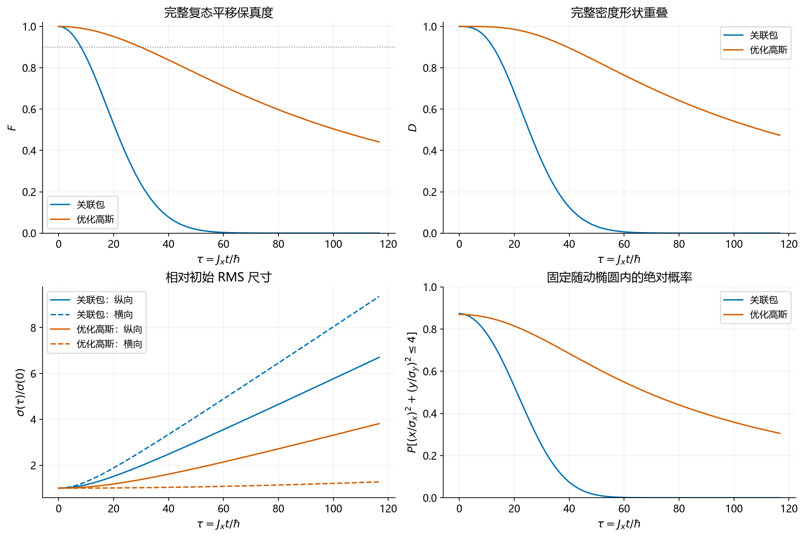
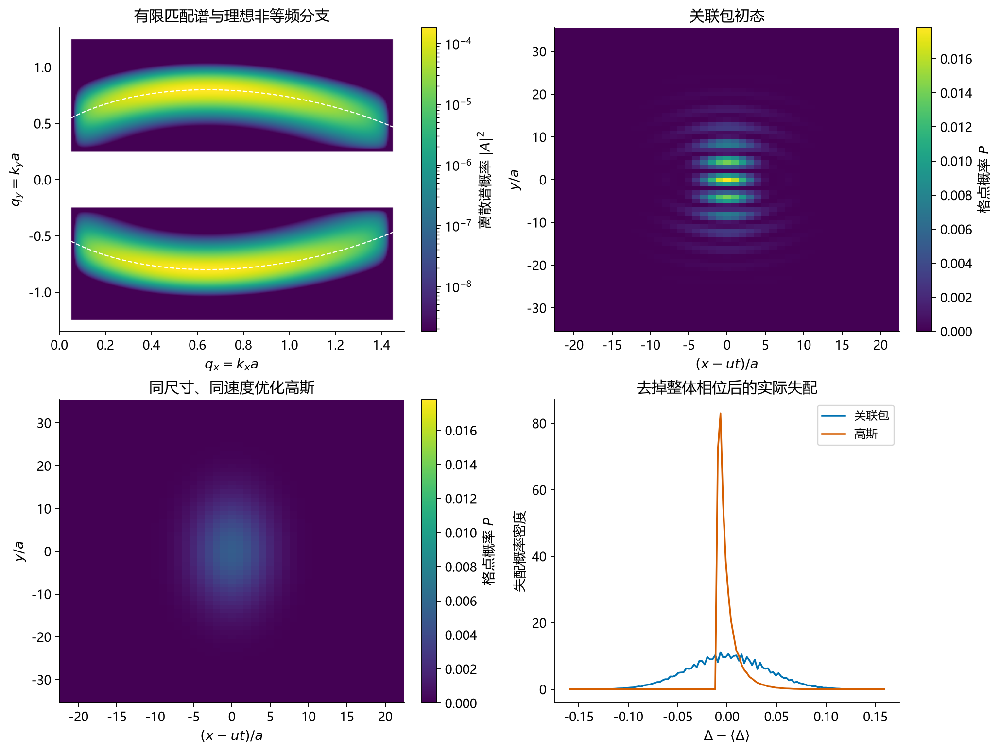
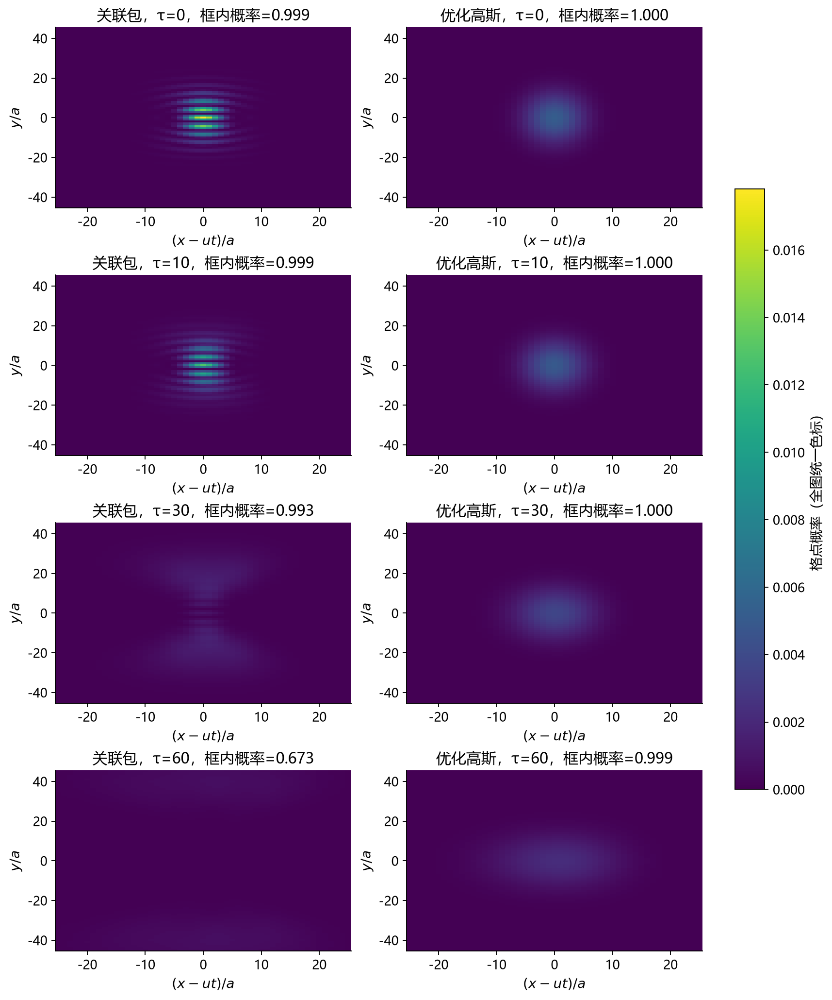
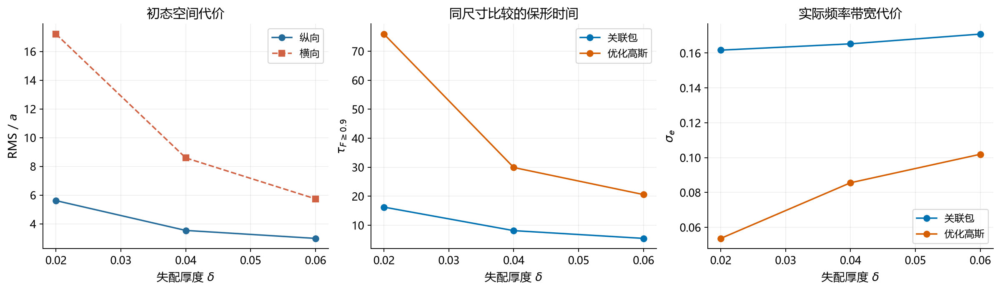

# 有限自旋波时空匹配波包：完整色散传播与同尺寸高斯比较

日期：2026-10-21。研究依据：[老师指导](../../teacher-dialogue.md)、[研究规划](../../paper-research-plan.md)、[匹配理论](../../theory/matching-foundations/matching-foundations.md)。

## 1. 本轮结论

已经构造了纵横 RMS 均有限、归一化的非等频关联波包，并用完整余弦色散完成自由传播模拟。在本轮选定的匹配族中，**关联确实减小了相同波矢边缘分布下的相位失配，但没有带来同尺寸、同平均输运速度条件下优于高斯的整体保形。**

主组初态的纵横 RMS 为 \((3.53760a,8.58793a)\)，两种波包范数均为一，平均速度均为 \((0.6,0)J_xa/\hbar\)。关联包保持 \(F\ge0.9\) 的时间为 \(8.1237\hbar/J_x\)，高斯为 \(29.8899\hbar/J_x\)。高斯约长 **3.68 倍**。

关联包有更高、更细的初始中央干涉结构，但需要更宽的频带和更高的平均激发能；横向两支产生较大的速度方差，有限包在随后传播中分裂。这个结果限制的是本轮分支、权重与资源设置，不是所有自旋波时空匹配方案的不可行性结论。



## 2. 选取的非等频匹配分支

模型保持为零场、无驱动、无阻尼的二维最近邻单磁子模型，\(J_x=J_y>0\)。记

\[
e(q_x,q_y)=2-\cos q_x-\cos q_y,
\quad q=ka,\quad \tau=J_xt/\hbar.
\]

目标沿 \(+x\) 方向，\(u=0.6\)。选取 \(q_{x*}=\arcsin0.6\)、\(q_{y*}=0.8\)，据此确定

\[
b=e(q_{x*},q_{y*})-u q_{x*}=0.1171926254.
\]

理想匹配集合是

\[
q_y=\pm\arccos(2-\cos q_x-uq_x-b),
\qquad e-uq_x=b.
\]

使用 \(q_x\in(0.05,1.45)\) 的片段，并保留 \(\pm q_y\) 对称两支，以取消横向平均速度。这两支共同构成本轮有限时空波包的谱。

该片段的 \(|q_y|\) 为约 0.4684—0.8000；沿线能量从约 0.1472 变化至 0.9872，因此不是等频谱。采样得到的最小 \(|\nabla(e-uq_x-b)|\) 约为 0.5983，避开了原有双拐点切平面的退化。将显式分支代回完整能带的残差不超过 \(3.4\times10^{-16}\)。

有限初态采用

\[
A\propto W_x(q_x)W_y(|q_y|)
\exp[-(q_x-Q)^2/(4s^2)]
\exp[-(e-uq_x-b)^2/(4\delta^2)],
\]

其中窗口平滑且具有有限支撑，\(|q_y|\) 窗口为 \((0.25,1.25)\)。归一化后求 \(Q\)，使实际 \(\langle\sin q_x\rangle=0.6\)。主组取 \(s=0.35\)、\(\delta=0.04\)。九组初态预检查后，按协议使用中间组展示，并对三个失配厚度做传播与代价比较，没有按是否胜过高斯选择展示组。



谱图使用对数色标，白色空白为零谱权重。两个空间图使用同一绝对概率色标。关联包包含有限包络下的干涉条纹，纵横都局域，但并非一个光滑的单峰高斯包。

## 3. 高斯怎样优化，比较是否公平

高斯初态的概率协方差写为

\[
C=\begin{pmatrix}
\sigma_x^2&\rho\sigma_x\sigma_y\\
\rho\sigma_x\sigma_y&\sigma_y^2
\end{pmatrix},
\]

其中两个对角宽度固定为各关联包的实测初宽。允许 \(\rho\in[-0.85,0.85]\)，并搜索三个归一化二次相位参数，各在 \([-1.5,1.5]\)。限制最小空间协方差本征值不小于 \(1.5^2a^2\)，以保证格点采样对应关系。

载波不是简单取 \(\arcsin0.6\)。对去掉载波的偶对称复高斯 \(f\)，先计算

\[
c_x=\operatorname{Re}\sum f_{m,n}^{*}f_{m+1,n},
\qquad \sin q_{x0}=0.6/c_x,
\]

以补偿有限带宽造成的平均速度变化。搜索两个纵向载波解，以及横向带底、带顶两种选择，总共四类。所有最终状态都重新检查平均速度。

各类使用固定种子的 differential evolution（4 个连续变量、popsize=6、18 代），再用 Powell 局部细化；将无空间相关、无二次相位的高斯显式纳入候选。目标是关联包首次下降到 \(F=0.5\) 的整个区间内，平移复态保真度的 Simpson 时间平均，不是某个终点聚焦。

三组搜索均没有找到优于零相关、零二次相位候选的连续参数。主组最终载波为 \((0.65105135,0)\)，其完整初始协方差也恰好与关联包一致。因此主展示不仅匹配了纵横尺寸，还匹配了初始二阶形状。

这是一项明确参数族内的搜索，DE 达到代数上限，不是数学全局最优证明。不过，本轮负向比较并不依赖证明高斯全局最优：显式的低能、零二次相位高斯已经显著优于关联包。扫描中个别离散载波分支的目标值几乎简并，全部候选与低能对照均保存在 [optimization.json](optimization.json) 和 [results.json](results.json)。

主要比较还固定了相同平均速度，因而等时间就是等平均传播距离。没有固定两种初态的频率带宽或平均激发能；这些量作为代价另行报告。

## 4. 完整色散传播结果

传播直接使用

\[
\widehat\psi(\tau)=A\exp[-i(2-\cos q_x-\cos q_y)\tau].
\]

没有用低阶色散展开或有限时间步进生成主结果。图示采用共同速度 \(u=0.6\) 的移动坐标，概率保持绝对归一化，不逐帧按峰值调亮。

场保真度 \(F\) 使用既定 Fourier 平移参考；密度重叠 \(D\)、尺寸和快照在 \(u\tau\) 为整数格距的时刻评估，避开非整数晶格插值对密度图的影响。

### 4.1 保形时间及距离

表中时间均为首次越过阈值的时间，单位 \(\hbar/J_x\)。主组：

| 阈值 | 关联包 | 高斯 | 高斯／关联包 |
|---|---:|---:|---:|
| \(F\ge0.9\) | 8.1237 | 29.8899 | 3.68 |
| \(F\ge0.8\) | 11.8221 | 45.9314 | 3.89 |
| \(F\ge0.5\) | 20.8340 | 101.0905 | 4.85 |

对应 \(F\ge0.9\) 的平均传播距离分别约为 **4.87a** 和 **17.93a**。关联包在这个阈值下只移动了约 1.38 个初始纵向 RMS 宽度。

### 4.2 形状和随动区域内的概率

随动区域定义为初始尺寸确定的固定椭圆
\((x-u\tau)^2/\sigma_x^2+y^2/\sigma_y^2\le4\)。

| 时间 | 对象 | \(F\) | \(D\) | \(\sigma_x/a\) | \(\sigma_y/a\) | 椭圆内概率 |
|---|---|---:|---:|---:|---:|---:|
| 0 | 关联包 | 1 | 1 | 3.538 | 8.588 | 0.874 |
| 0 | 高斯 | 1 | 1 | 3.538 | 8.588 | 0.869 |
| 10 | 关联包 | 0.852 | 0.943 | 4.069 | 10.985 | 0.779 |
| 10 | 高斯 | 0.987 | 0.999 | 3.710 | 8.608 | 0.856 |
| 30 | 关联包 | 0.237 | 0.349 | 6.993 | 22.273 | 0.249 |
| 30 | 高斯 | 0.899 | 0.951 | 4.871 | 8.763 | 0.754 |
| 60 | 关联包 | 0.003 | 0.006 | 12.571 | 41.990 | 0.0013 |
| 60 | 高斯 | 0.711 | 0.764 | 7.575 | 9.269 | 0.549 |



快照是固定显示窗口，标题给出框内实际概率。晚时关联包的大量概率离开显示框与中央随动椭圆；完整分布和指标使用全计算盒，不把图像裁剪误当作损耗。

### 4.3 中央峰的优势存在，但并不持久

关联包初始中心格点概率为 0.017809，高斯为 0.005239，前者约高 **3.40 倍**。初始中央 \(3\times3\) 格点内的概率分别为 0.10456 与 0.04571。

在 \(\tau=10\)，关联包中心附近仍较亮：峰值约为高斯的 2.59 倍。但到 \(\tau=30\)，关联包全局峰值已低于高斯，中央 \(3\times3\) 格点概率也降至约 0.00582，而高斯仍为约 0.03305。

因此，本轮结构可以提供短距离中央概率增强，不能称为更持久的完整保形。它不是无损条件下概率消失，而是条纹与包络重新分布。

## 5. 代价和机制

### 5.1 频带、能量与空间资源

主组数据：

| 量 | 关联包 | 高斯 | 含义 |
|---|---:|---:|---|
| 频率 RMS 带宽 \(\sigma_e\) | 0.16529 | 0.08557 | 关联包约为 1.93 倍 |
| 平均激发能 \(\langle e\rangle\) | 0.51773 | 0.21415 | 关联包约为 2.42 倍 |
| 失配标准差 \(\sigma_\Delta\) | 0.03996 | 0.01140 | 高斯的整体平移失配反而更小 |
| 包含 90% 概率的圆半径 | 15.52a | 14.56a | 同 RMS 下分布形状仍不同 |
| 包含 95% 概率的圆半径 | 17.26a | 17.12a | 本组初始远尾代价并不悬殊 |

物理角频率带宽为 \((J_x/\hbar)\sigma_e\)，平均激发能为 \(J_x\langle e\rangle\)。这不是实际天线输入功率或微波能耗的计算；本轮没有建立激发器模型。

在比较失配分布时，先减去各自的平均失配。不同的常数 \(b\) 只改变整体相位，不能因为高斯不围绕关联包所选的同一个平面偏移便人为惩罚它。图中显示的是 \(\Delta-\langle\Delta\rangle\)。

### 5.2 为什么横向展宽很快

两支谱的横向平均速度互相抵消，但各自主要向正负横向传输。零平均横向速度不意味着零速度方差。

本组测得

\[
\operatorname{Var}(v_y)_{\rm corr}=0.46928,
\qquad
\operatorname{Var}(v_y)_{\rm G}=0.003378.
\]

由于所用初态的初始位置—速度对称协方差为零，完整模型的矩关系给出

\[
\sigma_y^2(\tau)=\sigma_y^2(0)
+\operatorname{Var}(v_y)\tau^2.
\]

关联包因而满足约
\(\sigma_y^2=73.7525+0.46928\tau^2\)，与直接传播的尺寸一致。有限横向包络不能无限提供理想曲线谱场的干涉背景，后续两个部分分离，中央结构减弱。

这个解释与老师的匹配机制一致：我们确实按频率—波矢关系选择了模式，但有限谱精度与有限局域范围仍决定保形代价。只检查理想曲线相位条件，尚不足以判断有限包的完整传播性能。

### 5.3 变薄匹配谱，是否能够解决问题

固定 \(s=0.35\)，每一行都重新匹配高斯初宽和平均速度：

| \(\delta\) | 初始 \(\sigma_x/a\) | 初始 \(\sigma_y/a\) | 关联包 \(\tau_{0.9}\) | 高斯 \(\tau_{0.9}\) |
|---:|---:|---:|---:|---:|
| 0.02 | 5.614 | 17.207 | 16.231 | 75.892 |
| 0.04 | 3.538 | 8.588 | 8.124 | 29.890 |
| 0.06 | 2.983 | 5.736 | 5.449 | 20.557 |

在这个范围内，减半 \(\delta\) 约使关联包寿命加倍，也约使其横向初宽加倍。这是本构造中的数值趋势，不是普适标度定理。同尺寸高斯在三组中均更持久。



### 5.4 去关联对照：机制有效，不等于同资源优势

主组使用相同的 \(q_x\)、\(q_y\) 边缘概率，构造乘积谱

\[
|A_{\rm sep}|^2=P_x(q_x)P_y(q_y).
\]

它保留平均能量、波矢边缘宽度和平均速度，去掉联合关联。失配标准差从关联包的 0.03996 增至 0.05966，\(F\ge0.9\) 时间由 8.124 降为 5.448。说明关联确实提供相位补偿。

但该乘积谱的初始 RMS 为 \((2.496a,7.145a)\)，小于关联包。这是一个机制消融，不是同尺寸性能基线。真正同尺寸的高斯寿命为 29.890；不能用 8.124 大于 5.448 便声称本方案优于已有高斯方法。

## 6. 数值核验与可信范围

- 主要传播使用 \(1024\times1024\) 格点；主组另用 \(2048\times2048\) 检查，保持物理格距不变。
- 主组放大盒后，抽查的 \(F\) 最大差约 \(1.8\times10^{-12}\)，\(D\) 最大差约 \(1.7\times10^{-9}\)，传播 RMS 相对差不超过约 \(1.1\times10^{-6}\)。
- 主组的初始纵横尺寸在两种状态间匹配至浮点精度，平均速度误差约 \(10^{-16}\)，整个过程范数漂移约 \(10^{-15}\)。
- 谱失配表达式与空间复态重叠相互核对；独立实空间最近邻算符的指数传播与谱传播在代表性时刻的 L2 差为 \(4.7\times10^{-15}\)。
- 直接传播的宽度与位置—速度矩公式一致，代表性全时段的相对残差约 \(10^{-8}\)。全程也检查了实验室坐标及移动坐标的盒边概率。
- 优化网格与最终网格的目标值差在主组约 \(10^{-15}\)；\(\delta=0.06\) 扫描点约为 \(1.7\times10^{-5}\)。最终寿命使用较大的传播网格重新计算，这一差异远小于两种状态的保形差距。

这些核验支持本轮比较，但不能把指定参数域搜索升级为所有高斯或所有匹配谱的最优性证明。没有微磁模拟、阻尼、有限天线或真实材料参数验证，也未完成新颖性核查。

## 7. 对下一阶段的约束

本轮已经实现老师要求的核心操作：从完整色散选择非等频模式，通过频率—波矢关联构造有限二维局域包，并检查其真实自由传播。结果表明，**仅把谱压在某条理想匹配曲线附近，并不足以在同尺寸预算下获得更好的整体保形。**

后续仍应围绕该机制研究，而不是换到无关题目。需要联合考虑匹配曲线、沿线权重和有限局域化条件，尤其限制横向群速度方差，并将局域中央增强与完整波包保持分开评价。当前选定的 \(u,b\)、双支权重和有限窗尚未做联合优化；不能从这一构造失败推出其他分支也必然失败。

是否有论文级新增结果，还需要更深入的构造或边界分析与最近邻文献核对。本轮应保留为明确的负向基线和资源代价记录，不能写成已实现优于高斯的保形传输。

## 8. 数据、动画与复现

- [传播动画](propagation.gif)：37帧，\(\tau=0\) 至60，所有帧共用绝对概率色标。
- [结果数据](results.json)、[优化记录](optimization.json)、[机制消融](controls.json)、[核验记录](verification.json)。
- [初始复谱](initial_states.npz)、[主组完整密度快照](main_snapshots.npz)。
- [预先记录的计算协议](protocol.md)、[运行脚本](run_experiment.py)、[图表说明与矢量文件入口](figure-manifest.json)。

在项目根目录按阶段运行：

```powershell
python research/spin-wave-spacetime-wavepackets/experiments/finite-matched-packet-2026-10-21/run_experiment.py --stage pilot
python research/spin-wave-spacetime-wavepackets/experiments/finite-matched-packet-2026-10-21/run_experiment.py --stage optimize
python research/spin-wave-spacetime-wavepackets/experiments/finite-matched-packet-2026-10-21/run_experiment.py --stage analyze
python research/spin-wave-spacetime-wavepackets/experiments/finite-matched-packet-2026-10-21/run_experiment.py --stage controls
python research/spin-wave-spacetime-wavepackets/experiments/finite-matched-packet-2026-10-21/run_experiment.py --stage figures
```

脚本复用项目现有色散函数，输出仅写入本实验目录。主图同时提供 PNG、SVG 与矢量 PDF，原有项目图表和受限论文获取状态没有被覆盖。
